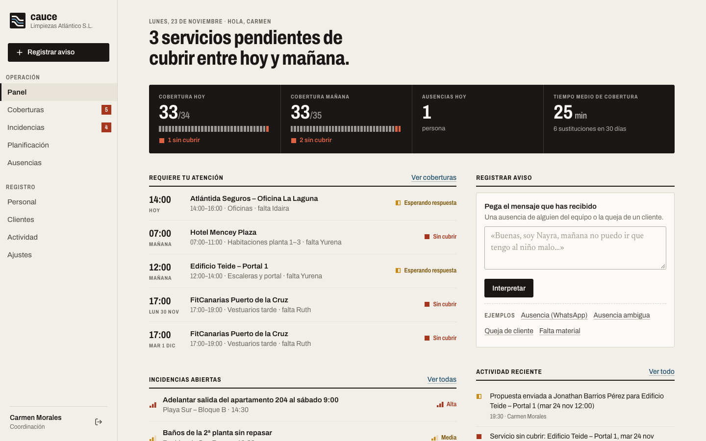
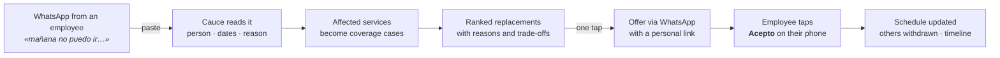
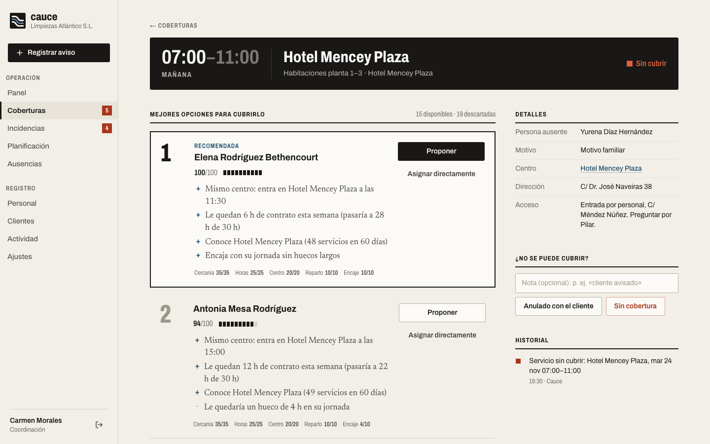
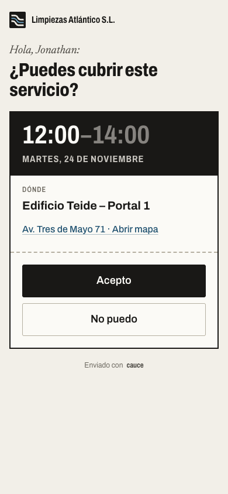
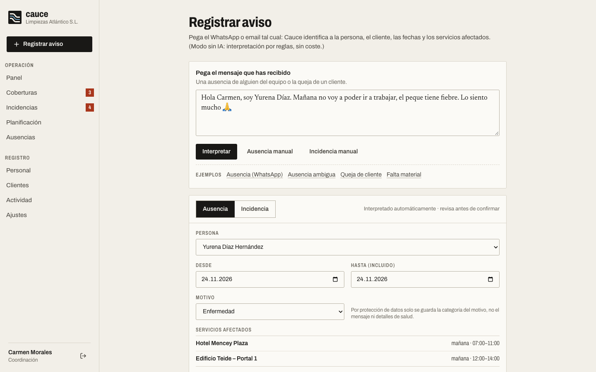
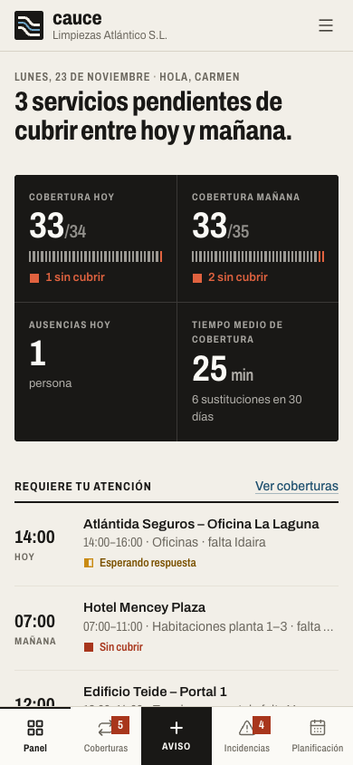

<p align="center">
  
</p>

<h1 align="center">Cauce</h1>

<p align="center">
  <b>De la ausencia a la cobertura confirmada.</b><br>
  An operations coordinator for professional cleaning companies — when someone can't make it to a service,
  Cauce finds the right replacement, explains why, asks them on WhatsApp and updates the schedule.
</p>

<p align="center">
  
  
  
  
  
</p>

<p align="center">
  
</p>

---

## Why

A cleaning company with 20–100 people runs on dozens of recurring contracts spread across many sites.
Every day someone can't come. The coordinator then has to work out which services are affected, who is
free, close enough, qualified and not already at their hours limit — and then phone or WhatsApp people
one by one until somebody says yes. That is six to ten messages and calls per absence, usually from a car.

Cauce turns that into a few taps, and keeps a clean record of what happened.

## How it works



1. **Paste the message as it arrived.** Cauce identifies who is writing (not who is greeted), the dates
   (`mañana`, `el jueves`, `del 30/12 al 2/1`…), the reason category and the services affected — and
   says what it isn't sure about ("there are two Marías: choose one").
2. **Every affected service becomes a coverage case** with a ranked shortlist of replacements.
3. **Send the offer** through a WhatsApp deep link (no WhatsApp Business API needed) or copy it.
   Each offer carries a personal link.
4. **The employee answers on their phone** — no app, no login. The first acceptance wins; every other
   offer is withdrawn; the schedule and the activity timeline update themselves.
5. **Client incidents** follow the same idea: paste the complaint, Cauce links it to the client, the site,
   the last service and the person who did it, and drafts the reply.

<table>
  <tr>
    <td width="62%"></td>
    <td width="38%"></td>
  </tr>
  <tr>
    <td><sub>A coverage case: the recommendation reads like an expert's notes, not a score.</sub></td>
    <td><sub>What the employee opens from WhatsApp.</sub></td>
  </tr>
</table>

## The recommendation is explainable, not magic

Ranking is **deterministic and auditable** — AI is only used to read free-text messages, and even that has
a free rules-based fallback, so Cauce runs with no API key and no per-message cost.

**Hard rules** — a person is excluded, with the reason shown, if they are absent that day, lack a required
qualification (e.g. *centros sanitarios*, *trabajo en altura*), are outside their availability, have an
overlapping service, **can't physically drive there in time** from their previous service, or would exceed the
weekly hours limit.

**Score** — everyone else is ranked on:

| Factor | Weight | Shown to the coordinator as |
|---|---:|---|
| Proximity (from home *or* from the previous/next service that day) | 35 | *A 0,7 km hasta Edificio Teide – Portal 2, donde empieza a las 15:00* |
| Contract hours (fill part-timers first, flag overtime) | 25 | *Le quedan 6 h de contrato esta semana* · *Horas extra: pasaría a 33 h con contrato de 30 h (+3 h)* |
| Knows the site | 20 | *Conoce Hotel Mencey Plaza (48 servicios en 60 días)* |
| Fairness (spread substitutions) | 10 | *Ya ha cubierto 2 sustituciones este mes* |
| Fits the rest of the day | 10 | *Encaja con su jornada sin huecos largos* |

Acceptance is re-validated at the moment someone taps *Acepto*, inside a write-locked transaction: a stale
link can't double-book a person, a late link for a service that already started is refused, and two people
can't both be confirmed for the same shift.

## Design: «Cal y picón»

The interface is meant to look like a working instrument, not a SaaS template. It borrows from the station
departures board (one dark band, big tabular times, one state per line) and from the coordinator's paper
planning sheet, in Canarian materials: **cal** (whitewash) paper, **picón** (volcanic black) ink, **almagre**
red for "not covered", **azufre** yellow for "waiting", Atlantic **mar** blue for "covered".
Status is never colour alone — every state has a shape and a word. Type is Archivo (with a condensed
"signage" width) for the system and Newsreader, a serif, only for people's words.

→ Full direction, tokens and the *"we never do"* list: [`docs/design.md`](docs/design.md)

<table>
  <tr>
    <td width="70%"></td>
    <td width="30%"></td>
  </tr>
  <tr>
    <td><sub>Message intake: a pasted WhatsApp becomes an absence with its affected services.</sub></td>
    <td><sub>Built for a coordinator in a car between sites.</sub></td>
  </tr>
</table>

## Features

| Area | What's there |
|---|---|
| **Coverage** | Absence intake from free text · coverage cases · ranked candidates with reasons, trade-offs and excluded list · WhatsApp/copy offers · employee response page · direct assignment · close as cancelled/unresolved · full per-case history |
| **Incidents** | Intake from a client's message · auto-linking to site, last service and responsible employee · owner, status, notes · drafted client reply |
| **Planning** | Day view per site · week grid with one mark per service so gaps stand out |
| **Data** | Staff (skills, weekly availability, contract hours, zone), clients, sites (access notes, required skills), recurring services with automatic shift generation · CSV import from Excel |
| **Dashboard** | Coverage today/tomorrow · open cases and incidents · average time-to-cover (the value metric) · activity timeline |

## Privacy & security

- **Multi-tenant from day one** — every query is scoped by organisation, including joins; ids from forms are re-checked server-side.
- **Data minimisation (RGPD)** — absences store only the reason *category*; the employee's message and any health detail are read in memory to fill the form and never persisted.
- **Site access notes** (keys, alarm codes) reach an employee's phone only after they are confirmed on that service.
- Response links are unguessable tokens that expire when the service starts · login throttling · scrypt password hashes · httpOnly session cookies.

## Architecture

| | |
|---|---|
| **App** | Next.js 16 (App Router, Server Components, Server Actions), React 19, TypeScript strict |
| **Data** | SQLite via Node's built-in `node:sqlite` — plain SQL, no ORM, no native build step |
| **Styling** | Tailwind CSS v4 with a custom token system; fonts self-hosted through `next/font` |
| **AI (optional)** | Anthropic SDK, structured output validated with zod; automatic fallback to the rules parser |
| **Tests** | `node --test` with in-memory databases — parser, ranking, workflow state machine, tenancy, privacy, shift generation |

One Node process and one database file: it runs on the smallest VPS and is trivial to back up.

```
src/
├── app/
│   ├── (app)/            # authenticated screens: panel, coberturas, incidencias, planificación, personal, clientes…
│   ├── r/[token]/        # public employee response page
│   ├── actions.ts        # server actions (coverage, incidents, settings)
│   └── admin-actions.ts  # server actions (staff, clients, sites, services)
├── components/           # shell, design-system primitives, forms
└── lib/                  # domain logic — pure, tested
    ├── ranking.ts        # hard rules + explainable score
    ├── coverage.ts       # absence → case → offer → confirmation state machine
    ├── parse-message.ts  # Spanish message understanding (rules)
    ├── ai.ts             # optional LLM layer with fallback
    └── services.ts       # recurring services → shifts
docs/
├── product-spec.md       # scope, entities, business rules, demo
├── decisions.md          # architecture & product decision log
├── design.md             # visual identity
└── workflow.md           # how humans and AI agents work on this repo
```

## Run it

Requires Node.js ≥ 22.13.

```bash
npm install
npm run demo:reset     # creates «Limpiezas Atlántico S.L.»: 35 people, 12 clients, 20 sites in Tenerife
npm run dev            # http://localhost:3000  —  demo@cauce.app / demo1234
```

**Four-minute demo:** on *Registrar aviso*, click the example *Ausencia (WhatsApp)* → *Interpretar* →
*Confirmar ausencia* → open *Hotel Mencey Plaza* → *Proponer* to the first candidate → *Ver enlace* (that's the
employee's phone) → *Acepto* → back on the case: covered, schedule and history updated.
Try *Ausencia ambigua* and *Queja de cliente* too.

```bash
npm test               # 53 tests
npm run typecheck && npm run lint && npm run build
```

To enable AI message reading, set `ANTHROPIC_API_KEY` (see `.env.example`). Without it everything works on the
built-in Spanish rules parser, at zero cost.

## How it was built

Cauce is built by a solo founder working with AI coding agents under an explicit operating model
([`AGENTS.md`](AGENTS.md), [`docs/workflow.md`](docs/workflow.md)): one coordinating thread, bounded tasks
delegated to separate agents in isolated git worktrees, an **independent review by a model from a different
provider**, and every durable decision recorded in [`docs/decisions.md`](docs/decisions.md).

## Status

Early product, preparing pilots with cleaning companies in the Canary Islands. UI in Spanish (English planned).

---

<sub>© 2026 Cauce. All rights reserved. This repository is public for reference; no licence is granted to use, copy or redistribute the code.</sub>
